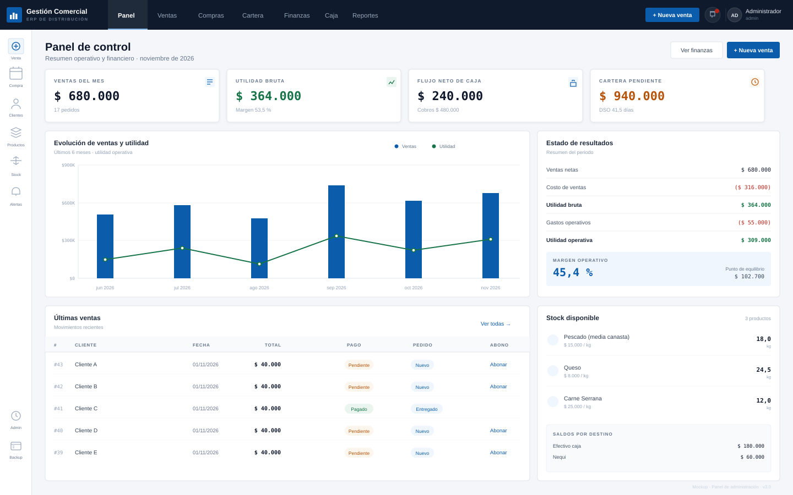

# Gestión Comercial

Sistema de gestión comercial para distribución de pescado, queso y carne.
Cubre ventas, compras, inventario, cartera, caja, finanzas y reportes, con
permisos separados para administración y vendedores.



## Estado del proyecto

| Campo | Valor |
|---|---|
| Versión | 3.0.0 |
| Periodo de construcción | Septiembre – noviembre de 2026 |
| Última actualización | 2 de noviembre de 2026 |
| Estado | Operativo en entorno local, preparado para despliegue controlado |
| Moneda | COP |
| Idioma | Español (Colombia) |

## Funcionalidades

### Operación

- Ventas con pago total, abono o crédito.
- Compras con proveedores, gastos y recepción.
- Inventario por kilos, canastas y unidades.
- Movimientos de stock y ajustes con motivo.
- Clientes y cartera por cobrar.
- Cobros por medio y destino del dinero.
- Alertas de deuda vencida y stock bajo.

### Administración

- Estado de resultados mensual.
- Flujo de caja y serie diaria.
- Indicadores: margen, punto de equilibrio, DSO, rotación y cobertura.
- Reportes mensuales en pantalla y PDF.
- Usuarios, roles y activación de cuentas.
- Copias de seguridad descargables.

### Seguridad

- Autenticación JWT con refresh token.
- Rate limiting persistido en MySQL.
- Roles jerárquicos: `admin`, `vendedor`, `readonly`.
- Restricciones aplicadas en backend y frontend.
- Secretos fuera del repositorio.
- Datos reales de clientes fuera de Git.

## Roles

| Rol | Alcance |
|---|---|
| Administrador | Operación completa, finanzas, compras, usuarios y respaldos |
| Vendedor | Ventas, cartera, clientes, productos, stock y alertas; sin costos ni utilidades |
| Solo lectura | Consulta de catálogo, ventas, cartera y alertas |

El vendedor no ve costos, márgenes, utilidades, compras, caja ni reportes.
La restricción se valida en la API, no solo en la interfaz.

## Tecnologías

| Capa | Tecnología |
|---|---|
| Frontend | React 18.3 · TypeScript 5.5 · Vite 5.4 · Tailwind CSS 3.4 |
| Estado y datos | TanStack Query 5 · Axios · React Hook Form |
| Gráficas | Recharts · Lucide React |
| Backend | PHP 8.4.27 · API REST propia |
| Base de datos | MySQL 8.0 |
| Servidor | nginx 1.27 |
| PDF | TCPDF 6.7 |
| Autenticación | firebase/php-jwt 6.10 |
| Infraestructura | Docker · Docker Compose |
| Calidad | TypeScript (tsc) · PHPUnit 11 |

## Documentación

| Documento | Contenido |
|---|---|
| [Índice](docs/README.md) | Ruta de lectura |
| [Visión general](docs/01-vision-general.md) | Alcance, fechas, stack y uso de IA |
| [Arquitectura](docs/02-arquitectura.md) | Capas, componentes y despliegue |
| [Modelo de datos](docs/03-modelo-datos.md) | Diagrama ER y diccionario |
| [Roles y permisos](docs/04-roles-permisos.md) | Matriz de acceso |
| [Manual del administrador](docs/05-manual-administrador.md) | Operación y control |
| [Manual del vendedor](docs/06-manual-vendedor.md) | Venta y cobro |
| [API REST](docs/07-api.md) | Endpoints y ejemplos |
| [Finanzas](docs/08-finanzas.md) | Fórmulas e interpretación |
| [Despliegue](docs/09-despliegue.md) | Instalación, respaldo y recuperación |
| [Roadmap](docs/10-roadmap.md) | Escáner QR y siguientes fases |
| [Mockups](docs/11-mockups.md) | Wireframes de las pantallas |

## Inicio rápido

### Requisitos

- Docker 24 o superior.
- Docker Compose v2.
- Puerto 8080 libre.

### Instalación

```bash
cp .env.example .env
```

Genera los secretos y edítalos en `.env`:

```bash
php -r "echo bin2hex(random_bytes(48));"   # JWT_SECRET
php -r "echo bin2hex(random_bytes(24));"   # DB_PASSWORD
php -r "echo bin2hex(random_bytes(24));"   # DB_ROOT_PASSWORD
```

Levanta los servicios:

```bash
docker compose up -d --build
```

Crea el administrador:

```bash
docker compose exec php php bin/reset-admin-password.php admin@gcom.local --create
```

Abre <http://localhost:8080>.

No existe usuario ni contraseña por defecto.

### Desarrollo local

```bash
cd client
npm install
npm run dev
```

Vite hace proxy de `/api` hacia `http://localhost:8080`.

## Estructura

```
gestion-comercial/
├── backend/              API PHP (controladores, servicios, repositorios)
├── client/               SPA React + TypeScript
├── database/
│   ├── migrations/       Esquema versionable
│   └── private/          Datos reales (ignorado por Git)
├── docker/               Imágenes y configuración de nginx y PHP
├── docs/                 Documentación y mockups
├── docker-compose.yml
└── .env.example
```

## Datos iniciales

Una instalación nueva carga solo el esquema, las categorías, los productos base
y los tipos de gasto. No incluye clientes, ventas ni pagos.

Los precios del catálogo base son valores de demostración; ajústalos a tu
operación desde **Productos** antes de vender.

Los dumps con información real viven en `database/private/`, están ignorados por
Git y se importan manualmente. Consulta el
[manual de despliegue](docs/09-despliegue.md#importar-datos-operativos).

## Seguridad

- `.env` y `database/private/` nunca se versionan.
- MySQL no publica puertos al host.
- nginx es el único punto de entrada.
- Login con bloqueo tras intentos fallidos.
- Errores internos ocultos en producción.
- Respaldos SQL descargables.

Antes de producción: activa HTTPS, restringe el acceso, programa respaldos y
prueba la restauración. Ver [despliegue](docs/09-despliegue.md#seguridad).

## Roadmap

La siguiente fase prioriza el **escáner de códigos QR**:

1. Escaneo de productos en ventas.
2. Cobro con QR y conciliación del pago.
3. Etiquetas QR por producto y lote.
4. Consulta de venta desde el recibo.

Después: facturación electrónica, IVA, lotes y vencimientos, multi-bodega, PWA
offline, WhatsApp y auditoría. Detalle en el [roadmap](docs/10-roadmap.md).

## Uso de inteligencia artificial

El proyecto se construyó con asistencia de IA para implementación, revisión y
documentación. Las reglas de negocio, los criterios financieros y las decisiones
de permisos fueron definidos y validados por el responsable del proyecto. No se
compartieron bases de datos ni datos personales de clientes con servicios de IA.
El detalle está en [visión general](docs/01-vision-general.md#uso-de-inteligencia-artificial).

## Licencia

Este proyecto se publica bajo **GNU Affero General Public License v3.0
(AGPL-3.0)**. Puedes usarlo, estudiarlo, modificarlo y redistribuirlo bajo los
términos de esa licencia. Ver [LICENSE](LICENSE).

Si necesitas integrarlo en un producto de código cerrado, ofrecerlo como
servicio sin publicar tus modificaciones o distribuirlo como marca blanca,
existe una **licencia comercial** alternativa. Ver
[COMMERCIAL.md](COMMERCIAL.md).

Copyright © 2026 Edwin Carabali. El titular conserva los derechos de autor y
otorga sobre el software las licencias descritas en este documento.
