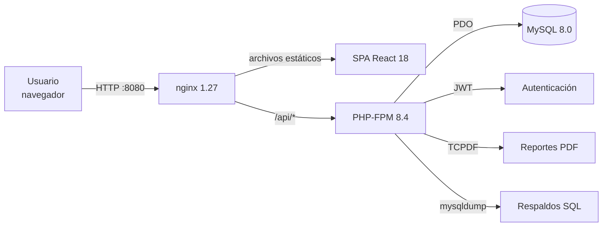
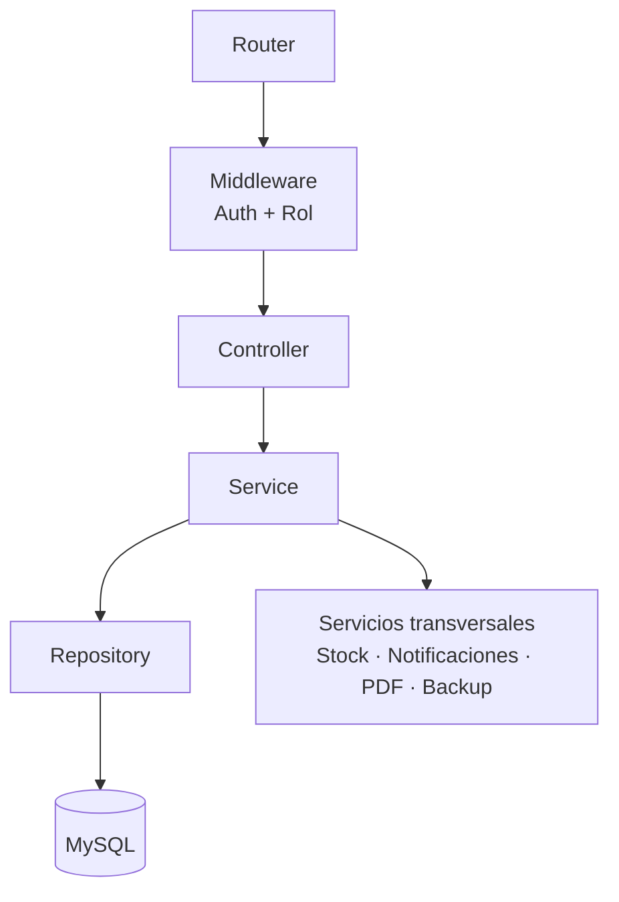
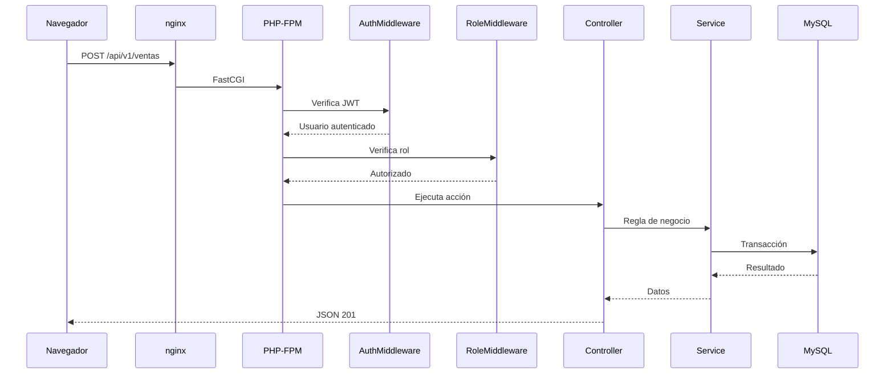
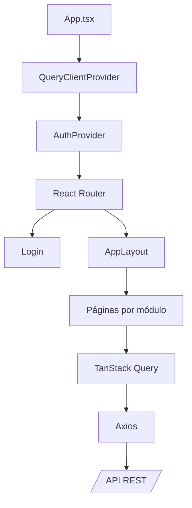
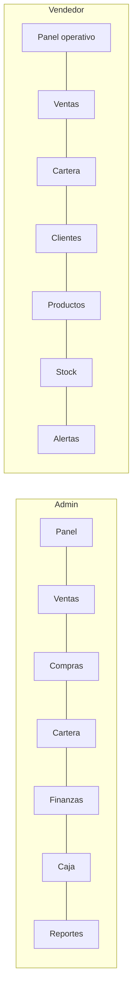
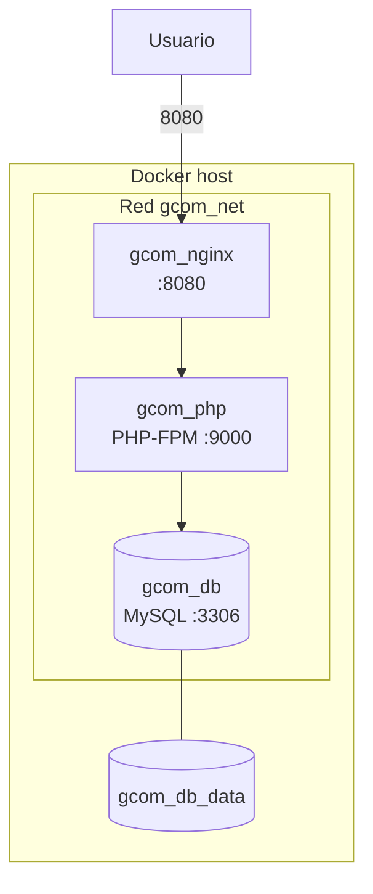

# 02 · Arquitectura

## Vista general

Gestión Comercial es una aplicación web de tres capas desplegada con Docker.
nginx sirve la SPA compilada y actúa como proxy inverso de la API; PHP-FPM
ejecuta la lógica de negocio y MySQL persiste los datos.

### Componentes

| Componente | Responsabilidad |
|---|---|
| nginx | Sirve el frontend, aplica la configuración de seguridad y enruta `/api` |
| React SPA | Interfaz, navegación, formularios y visualización |
| PHP-FPM | API REST, reglas de negocio, validaciones y permisos |
| MySQL | Datos transaccionales, vistas y triggers |
| Volumen `gcom_db_data` | Persistencia de la base de datos |
| Volumen `/var/www/vendor` | Dependencias PHP dentro del contenedor |

## Arquitectura del backend

El backend sigue una separación por capas con inyección de dependencias manual
en el arranque de rutas.

| Capa | Ubicación | Responsabilidad |
|---|---|---|
| Núcleo | `backend/src/Core` | Router, Request, Response, Database, Config |
| Middleware | `backend/src/Middleware` | Validación de JWT y jerarquía de roles |
| Controladores | `backend/src/Controllers` | Entrada HTTP, validación de campos, respuesta |
| Servicios | `backend/src/Services` | Reglas de negocio y transacciones |
| Repositorios | `backend/src/Repositories` | Consultas SQL y mapeo de datos |
| Excepciones | `backend/src/Exceptions` | Errores de negocio, validación y base de datos |
| Configuración | `backend/config` | Rutas, entorno y arranque |

### Flujo de una petición

## Arquitectura del frontend

| Elemento | Función |
|---|---|
| `AuthContext` | Sesión, rol, cierre de sesión y limpieza de caché |
| `AppLayout` | Barra superior, riel lateral y drawer móvil |
| `ProtectedRoute` | Exige sesión activa |
| `AdminOnly` | Restringe rutas de administración |
| `api/endpoints.ts` | Cliente tipado de la API |
| `components/ui` | Botones, tarjetas, tablas, modales y badges |
| `utils/format` | Formato de moneda, cantidades y fechas |

### Navegación por rol

## Modelo de despliegue

- MySQL no publica puertos al host.
- nginx es el único punto de entrada.
- El backend se monta como volumen para desarrollo; el `vendor` se conserva
  dentro del contenedor.
- El frontend se compila dentro de la imagen de nginx.

## Decisiones técnicas

| Decisión | Motivo |
|---|---|
| JWT sin estado | Escalabilidad y separación entre SPA y API |
| Proxy inverso para `/api` | Evita CORS y URLs absolutas |
| Triggers para totales | Consistencia aun con escrituras directas |
| Vistas para cartera y caja | Consultas reutilizables y simples |
| Roles jerárquicos | Menos configuración y reglas claras |
| Caché de React Query | Navegación rápida y menos peticiones |
| Limpieza de caché al cambiar sesión | Evita fuga de datos entre usuarios |

## Riesgos y controles

| Riesgo | Control |
|---|---|
| Acceso indebido a información financiera | Validación de rol en backend y frontend |
| Fuerza bruta en login | Rate limiting persistido por email e IP |
| Pérdida de datos | Respaldos descargables y volumen persistente |
| Exposición de secretos | `.env` fuera del repositorio |
| Datos reales en el repositorio | `database/private/` ignorado |
| Errores internos expuestos | Respuestas genéricas en producción |
| Inconsistencia de stock | Movimientos y transacciones en servicios |
