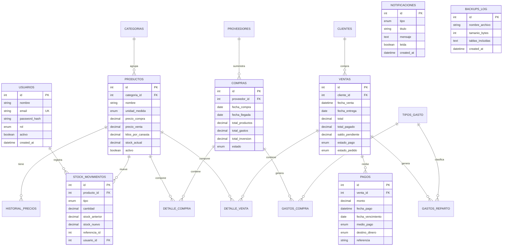

# 03 · Modelo de datos

## Diagrama entidad-relación



## Diccionario de tablas

### Operación

| Tabla | Propósito | Campos clave |
|---|---|---|
| `usuarios` | Cuentas y roles | `email` único, `rol`, `activo` |
| `login_intentos` | Rate limiting | `email`, `ip`, `exitoso`, `created_at` |
| `categorias` | Agrupación de productos | `nombre`, `descripcion` |
| `productos` | Catálogo y stock | `precio_compra`, `precio_venta`, `kilos_por_canasta` |
| `historial_precios` | Cambios de precio | `producto_id`, `motivo`, `fecha` |
| `stock_movimientos` | Entradas y salidas | `tipo`, `cantidad`, `stock_anterior`, `stock_nuevo` |
| `clientes` | Datos de clientes | `nombre`, `telefono`, `direccion` |
| `proveedores` | Datos de proveedores | `nombre`, `ciudad`, `telefono` |
| `compras` | Cabecera de compra | `total_productos`, `total_gastos`, `estado` |
| `detalle_compra` | Líneas de compra | `cantidad`, `precio_unitario`, `subtotal` |
| `gastos_compra` | Gastos asociados | `tipo_gasto_id`, `monto` |
| `ventas` | Cabecera de venta | `total`, `total_pagado`, `saldo_pendiente` |
| `detalle_venta` | Líneas de venta | `cantidad`, `precio_unitario`, `subtotal` |
| `pagos` | Cobros y abonos | `monto`, `medio_pago`, `destino_dinero` |
| `gastos_reparto` | Gastos de entrega | `venta_id`, `monto` |
| `tipos_gasto` | Catálogo de gastos | `nombre`, `categoria` |
| `notificaciones` | Alertas del sistema | `tipo`, `leida`, `referencia_id` |
| `backups_log` | Bitácora de respaldos | `nombre_archivo`, `tamanio_bytes` |

## Reglas de integridad

### Llaves y relaciones

- `usuarios.email` es único.
- `productos.categoria_id` referencia `categorias.id`.
- `detalle_compra.compra_id` y `detalle_venta.venta_id` eliminan en cascada.
- `pagos.venta_id` elimina en cascada.
- `compras.proveedor_id` y `ventas.cliente_id` son opcionales.

### Campos calculados

| Campo | Fórmula | Tabla |
|---|---|---|
| `total_inversion` | `total_productos + total_gastos` | `compras` |
| `detalle_compra.subtotal` | `cantidad × precio_unitario` | `detalle_compra` |
| `detalle_venta.subtotal` | `cantidad × precio_unitario` | `detalle_venta` |
| `ventas.saldo_pendiente` | `total − total_pagado` | `ventas` |

### Triggers

| Trigger | Efecto |
|---|---|
| `trg_dc_insert` | Recalcula `compras.total_productos` |
| `trg_gc_insert` | Recalcula `compras.total_gastos` |
| `trg_dv_insert` | Recalcula `ventas.total` |
| `trg_dv_delete` | Recalcula `ventas.total` al borrar una línea |
| `trg_pago_insert` | Recalcula `total_pagado` y `estado_pago` |

### Vistas

| Vista | Contenido |
|---|---|
| `v_cartera` | Clientes con saldo pendiente, pedidos, ventas y pagos |
| `v_caja` | Cobros agrupados por fecha, medio y destino |

## Normalización de costos

Los productos pueden venderse por kilo, canasta o unidad. Para comparar costos
y calcular márgenes, el sistema normaliza el costo a la unidad de venta:

```
costo_por_kg = precio_compra / kilos_por_canasta     (si es canasta)
costo_por_kg = precio_compra                          (si es kilo o unidad)
```

Esta misma lógica se usa en:

- `ProductoRepository` para el margen por producto.
- `FinanzasService` para el costo de ventas.
- El valor del inventario en los indicadores.

## Crecimiento previsto

El esquema actual soporta la operación de una sola bodega. Para las siguientes
etapas se prevé:

- `lotes` y `lotes_movimientos` para trazabilidad.
- `bodegas` y `stock_por_bodega` para inventario multipunto.
- `impuestos` y `ventas_impuestos` para IVA.
- `facturas_electronicas` para integración con la DIAN.
- `codigos_qr` para etiquetas por lote y cobros. El código de producto
  (`GCOM-P-0001`) se deriva del identificador y no requiere una columna extra.
- `auditoria` para registrar cambios sensibles.
