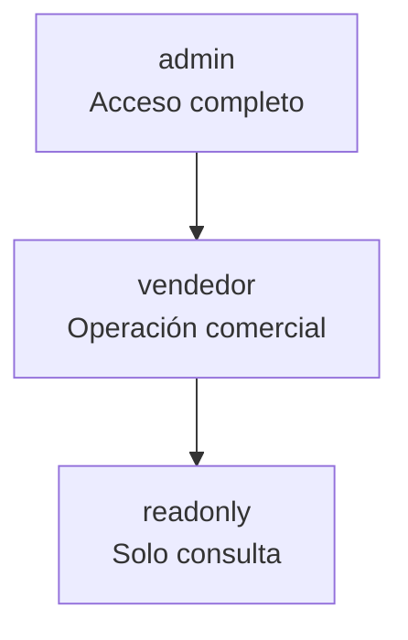
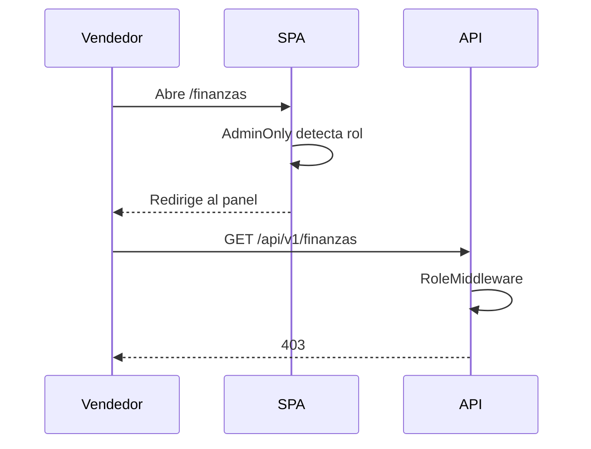

# 04 · Roles y permisos

## Jerarquía

Un rol hereda los permisos de los roles inferiores, con las excepciones
explícitas de negocio que se describen abajo.

| Rol | Descripción |
|---|---|
| `admin` | Dueño o administrador. Ve finanzas, costos, compras y configuración. |
| `vendedor` | Operación comercial. Vende, cobra y consulta sin ver utilidades. |
| `readonly` | Consulta. No crea ni modifica registros. |

## Matriz de acceso

### Módulos visibles

| Módulo | Admin | Vendedor | Readonly |
|---|---|---|---|
| Panel operativo | Sí | Sí | Sí |
| Panel financiero | Sí | No | No |
| Ventas | Sí | Sí | Sí |
| Nueva venta | Sí | Sí | No |
| Compras | Sí | No | No |
| Nueva compra | Sí | No | No |
| Cartera | Sí | Sí | Sí |
| Clientes | Sí | Sí | Sí |
| Productos | Sí | Sí | Sí |
| Stock | Sí | Sí | Sí |
| Alertas | Sí | Sí | Sí |
| Finanzas | Sí | No | No |
| Caja | Sí | No | No |
| Reportes | Sí | No | No |
| Administración | Sí | No | No |
| Copias de seguridad | Sí | No | No |

### Acciones sobre la API

| Endpoint | Admin | Vendedor | Readonly |
|---|---|---|---|
| `GET /dashboard` | Sí | Sí, sin costos | Sí, sin costos |
| `GET /productos` | Sí | Sí, sin costos | Sí, sin costos |
| `GET /productos/{id}` | Sí | Sí, sin costos | Sí, sin costos |
| `PUT /productos/{id}/precio` | Sí | No | No |
| `GET /productos/{id}/historial` | Sí | No | No |
| `PATCH /productos/{id}/stock` | Sí | No | No |
| `GET /stock/movimientos` | Sí | Sí | Sí |
| `GET /ventas` | Sí | Sí | Sí |
| `POST /ventas` | Sí | Sí | No |
| `PUT /ventas/{id}` | Sí | Sí | No |
| `DELETE /ventas/{id}` | Sí | No | No |
| `POST /ventas/{id}/pagos` | Sí | Sí | No |
| `GET /compras` | Sí | No | No |
| `POST /compras` | Sí | No | No |
| `PUT /compras/{id}` | Sí | No | No |
| `PATCH /compras/{id}/estado` | Sí | No | No |
| `GET /clientes` | Sí | Sí | Sí |
| `POST /clientes` | Sí | Sí | No |
| `PUT /clientes/{id}` | Sí | Sí | No |
| `GET /cartera` | Sí | Sí | Sí |
| `GET /caja` | Sí | No | No |
| `GET /finanzas` | Sí | No | No |
| `GET /reportes/mensual` | Sí | No | No |
| `GET /reportes/mensual/pdf` | Sí | No | No |
| `GET /notificaciones` | Sí | Sí | Sí |
| `GET /usuarios` | Sí | No | No |
| `POST /auth/register` | Sí | No | No |
| `GET /backup/generar` | Sí | No | No |
| `GET /backup/historial` | Sí | No | No |

## Reglas de negocio por rol

### Vendedor

- Opera ventas, abonos, clientes y consultas de stock.
- No ve `precio_compra`, `costo_por_kg` ni `margen_porcentaje`.
- No ve inversión, ganancia bruta, margen, utilidad operativa ni saldos por destino.
- No puede registrar ni editar compras.
- No puede eliminar ventas.
- No puede cambiar precios ni ajustar stock.
- No puede descargar reportes.

### Administrador

- Acceso completo a la operación y a la información financiera.
- Responsable de compras, precios, ajustes de inventario y usuarios.
- Recibe el panel financiero con estado de resultados y flujo de caja.

### Solo lectura

- Consulta catálogo, ventas, cartera y alertas.
- No puede crear ventas, clientes ni pagos.
- No accede a información financiera.

## Implementación

La restricción se aplica en dos niveles:

1. **Backend:** `AuthMiddleware` valida el JWT y `RoleMiddleware` verifica el rol
   antes de ejecutar el controlador.
2. **Frontend:** la navegación se filtra por rol y las rutas sensibles usan
   `AdminOnly`; además se ocultan acciones que el backend rechazaría.

El frontend nunca es la única barrera: aunque se fuerce la URL o se invoque la
API directamente, el servidor responde `403`.

## Administración de usuarios

Desde **Administración**, el rol `admin` puede:

- Crear usuarios con nombre, correo, contraseña y rol.
- Cambiar el rol de un usuario.
- Activar o desactivar cuentas.
- Restablecer contraseñas desde consola con `bin/reset-admin-password.php`.

Recomendaciones:

- Una cuenta por persona.
- Desactivar en lugar de eliminar.
- Revisar periódicamente las cuentas activas.
- No compartir credenciales.
- Usar contraseñas largas y únicas.
