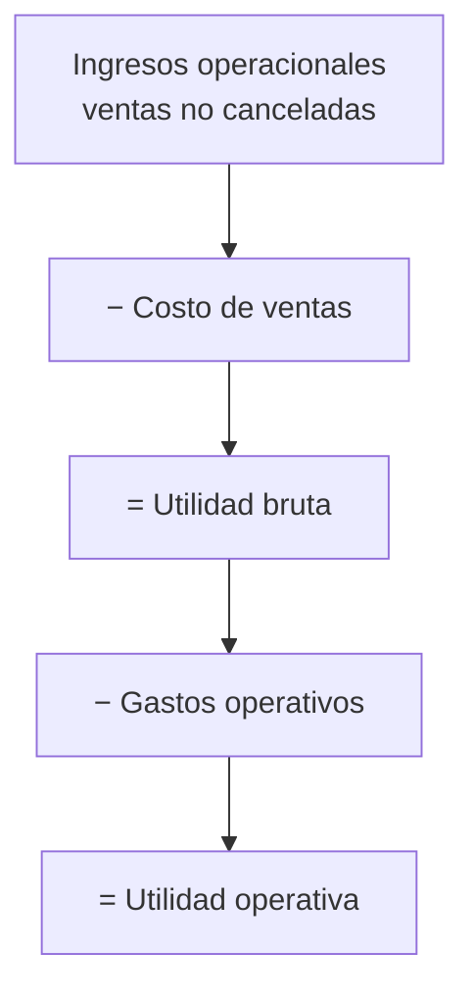

# 08 · Finanzas

## Criterio general

El módulo de finanzas trabaja con dos perspectivas distintas:

| Perspectiva | Base | Uso |
|---|---|---|
| Devengado | Ventas del periodo | Estado de resultados |
| Caja | Pagos y compras del periodo | Flujo de caja |

No se maneja IVA en esta versión. El estado de resultados queda preparado para
incorporarlo como una línea adicional.

## Estado de resultados



### Fórmulas

```
Ingresos operacionales = Σ ventas.total del periodo
                         (estado_pedido ≠ cancelado)

Costo de ventas        = Σ detalle_venta.cantidad × costo_unitario

costo_unitario         = productos.precio_compra
                         si unidad = canasta:
                           precio_compra / kilos_por_canasta

Utilidad bruta         = Ingresos − Costo de ventas

Gastos operativos      = gastos_compra + gastos_reparto del periodo

Utilidad operativa     = Utilidad bruta − Gastos operativos

Margen bruto           = Utilidad bruta / Ingresos × 100
Margen operativo       = Utilidad operativa / Ingresos × 100
```

### Notas de criterio

- Las ventas canceladas no suman ingresos ni costos.
- El costo se toma del precio de compra configurado, no del histórico de compras.
- Para productos por canasta el costo se normaliza a kilo.
- Los gastos de compra incluyen transporte, almacenamiento y otros.
- Los gastos de reparto se imputan al periodo en que se registran.

## Flujo de caja

```
Ingresos de caja = Σ pagos.monto del periodo
Egresos de caja  = Σ compras.total_inversion del periodo
Flujo neto       = Ingresos − Egresos

Posición de caja = Σ pagos históricos − Σ compras históricas
```

La **posición de caja** es una referencia histórica. No representa el saldo real
de una cuenta bancaria, porque no concilia saldos iniciales, retiros, préstamos
ni otros movimientos ajenos al sistema.

### Serie diaria

Para cada día del mes:

```
neto_dia   = cobros_dia − compras_dia
acumulado  = acumulado_anterior + neto_dia
```

## Indicadores

| Indicador | Fórmula | Lectura |
|---|---|---|
| Ticket promedio | Ventas / pedidos | Valor medio por venta |
| Margen bruto | Utilidad bruta / ventas | Rentabilidad antes de gastos |
| Margen operativo | Utilidad operativa / ventas | Rentabilidad final |
| Punto de equilibrio | Gastos / margen bruto | Ventas necesarias para cubrir gastos |
| Cartera | Σ saldo_pendiente | Deuda total por cobrar |
| DSO | Cartera / (ventas / 30) | Días promedio de cobro |
| Rotación de inventario | Costo de ventas / valor inventario | Veces que rota el inventario |
| Valor inventario | Σ stock × costo unitario | Capital inmovilizado |
| Crecimiento de ventas | (Ventas − ventas mes anterior) / anterior | Variación mensual |
| Cartera sobre ventas | Cartera / ventas × 100 | Peso de la deuda |
| Cobertura de gastos | Utilidad bruta / gastos | Capacidad de cubrir gastos |
| Compras del mes | Σ compras | Inversión del periodo |
| Flujo neto | Cobros − compras | Caja generada o consumida |

## Tendencias

El sistema calcula seis meses hacia atrás con:

- Ventas.
- Costo.
- Utilidad bruta.
- Gastos.
- Utilidad operativa.
- Cobros.
- Compras.
- Flujo.

El comparativo muestra el mes anterior para contextualizar el resultado.

## Interpretación práctica

### Si la utilidad bruta es positiva pero la operativa es negativa

Los gastos operativos están consumiendo el margen. Revisar transporte,
almacenamiento y reparto.

### Si el flujo neto es negativo pero la utilidad es positiva

Puede haber compras altas o cobros lentos. Revisar cartera y calendario de
compras.

### Si el DSO sube

Los clientes están pagando más lento. Reforzar cobro y revisar crédito.

### Si la rotación baja

Hay inventario inmovilizado. Revisar compras y demanda real.

### Si el punto de equilibrio se acerca a las ventas

El negocio tiene poco colchón. Revisar precios y gastos fijos.

## Limitaciones actuales

- No hay IVA.
- No hay depreciación.
- No hay nómina.
- No hay conciliación bancaria.
- El costo usa el precio configurado, no el costo promedio ponderado.
- No hay centros de costo ni sucursales.

## Preparación para IVA

El diseño permite incorporar IVA sin rehacer el modelo:

1. Agregar `impuestos` y `producto_impuesto`.
2. Guardar `subtotal`, `impuesto` y `total` en ventas y compras.
3. Añadir la línea de impuestos al estado de resultados.
4. Separar ingreso gravado, exento y excluido.
5. Ajustar reportes y facturación electrónica.

## Preparación para facturación electrónica

Se requiere:

- Resolución de facturación.
- Numeración y CUFE.
- Integración con un proveedor autorizado.
- Envío a la DIAN.
- Representación gráfica.
- Notas crédito y débito.

Ver [10 · Roadmap](10-roadmap.md).
