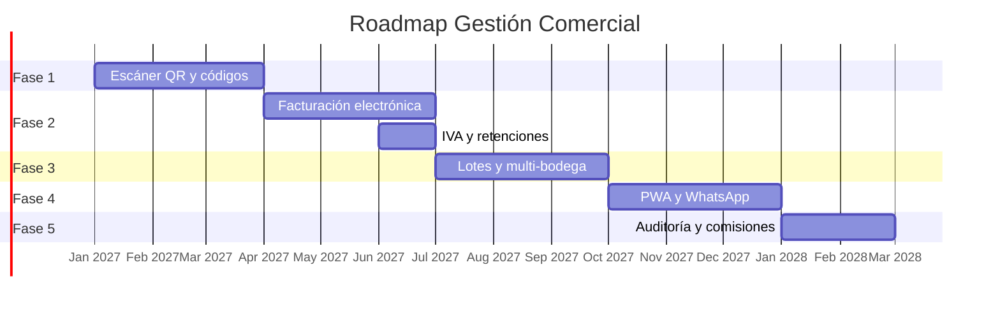
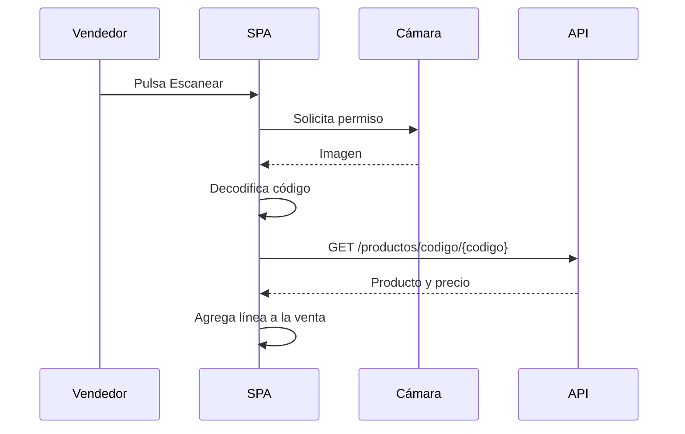
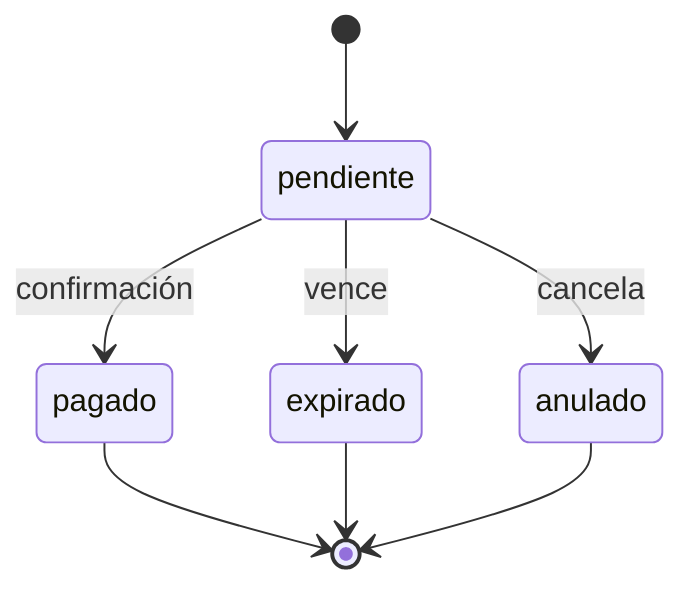

# 10 · Roadmap

## Criterio de priorización

Las siguientes funciones se ordenan por impacto operativo, esfuerzo de
implementación y dependencias técnicas. La primera etapa es el **escáner de
códigos QR**, solicitado como siguiente evolución del producto.

| Prioridad | Criterio |
|---|---|
| P0 | Desbloquea operación o reduce riesgo |
| P1 | Ahorra tiempo o mejora control |
| P2 | Mejora experiencia o análisis |
| P3 | Exploración futura |

## Resumen

| Fase | Foco | Periodo estimado | Prioridad |
|---|---|---|---|
| 1 | Escáner QR y códigos de barras | Q1 2027 | P0 |
| 2 | Facturación electrónica e IVA | Q2 2027 | P0 |
| 3 | Inventario avanzado | Q3 2027 | P1 |
| 4 | Operación móvil y cliente | Q3–Q4 2027 | P1 |
| 5 | Analítica y control | Q4 2027 | P2 |



---

## Fase 1 · Escáner QR y códigos de barras

### Objetivo

Reducir errores de digitación y acelerar ventas, cobros e inventario usando la
cámara del dispositivo o un lector USB.

### Casos de uso

| Caso | Descripción | Impacto |
|---|---|---|
| Venta por escaneo | Escanear el código del producto y agregarlo a la venta | Alto |
| Cobro con QR | Generar un QR con el monto y conciliar el pago | Alto |
| Etiqueta de producto | QR con producto, lote y peso | Medio |
| Consulta de venta | QR en el recibo para abrir el estado del pedido | Medio |
| Recepción de compra | Escanear mercancía recibida | Medio |

### 1.1 Venta por escaneo

Flujo:



Requisitos:

- Campo `codigo` único por producto en `productos`.
- Soporte de QR y código de barras (EAN-13, Code 128).
- Búsqueda por código en la API.
- Validación de producto activo y stock.
- Confirmación visual y sonora al escanear.
- Entrada manual como respaldo.

Implementación sugerida:

- `BarcodeDetector` nativo cuando esté disponible.
- `@zxing/browser` o `jsqr` como respaldo.
- Lectores USB se comportan como teclado: capturar entrada rápida.
- La cámara requiere HTTPS o `localhost`.

### 1.2 Cobro con QR

Dos modalidades:

| Modalidad | Uso |
|---|---|
| QR estático del negocio | El cliente escanea y digita el monto |
| QR dinámico por venta | El QR lleva venta y monto; facilita conciliación |

El QR dinámico no reemplaza la confirmación del pago. El vendedor debe verificar
la transacción en la app del banco o billetera y registrarla.

Flujo propuesto:

1. Se elige la venta y el monto.
2. El sistema genera un identificador de cobro.
3. Se muestra el QR.
4. El cliente paga.
5. El vendedor confirma el pago.
6. Se registra en `pagos` con `referencia`.
7. El estado de la venta se actualiza.

Modelo propuesto:

```sql
CREATE TABLE cobros_qr (
  id            INT UNSIGNED AUTO_INCREMENT PRIMARY KEY,
  venta_id      INT UNSIGNED NOT NULL,
  monto         DECIMAL(12,2) NOT NULL,
  estado        ENUM('pendiente','pagado','expirado','anulado') NOT NULL DEFAULT 'pendiente',
  codigo        VARCHAR(64) NOT NULL UNIQUE,
  expira_at     DATETIME NOT NULL,
  pagado_at     DATETIME NULL,
  referencia    VARCHAR(100) NULL,
  created_at    DATETIME NOT NULL DEFAULT CURRENT_TIMESTAMP,
  FOREIGN KEY (venta_id) REFERENCES ventas(id)
);
```

Estados:



### 1.3 Etiquetas QR

- QR por producto para conteo rápido.
- QR por lote para trazabilidad.
- QR por canasta con peso y fecha.
- Impresión en etiquetas de 50 × 30 mm.

### 1.4 Consulta de venta

El recibo incluye un QR con una URL firmada:

```
https://dominio/consulta/{token}
```

Muestra estado del pedido, saldo y fecha de entrega. No expone datos de otros
clientes. El token expira.

### 1.5 Requisitos técnicos

| Requisito | Detalle |
|---|---|
| HTTPS | Obligatorio para cámara en producción |
| Permisos | Solicitar cámara solo al escanear |
| Rendimiento | Procesar sin bloquear la interfaz |
| Compatibilidad | Chrome, Edge y Safari móvil |
| Respaldo | Entrada manual siempre disponible |
| Seguridad | No almacenar imágenes ni video |
| Accesibilidad | Confirmación visual y sonora |

### 1.6 Cambios de modelo

```sql
ALTER TABLE productos
  ADD COLUMN codigo VARCHAR(64) NULL UNIQUE,
  ADD COLUMN codigo_barras VARCHAR(64) NULL UNIQUE;

CREATE TABLE codigos_escaneados (
  id          INT UNSIGNED AUTO_INCREMENT PRIMARY KEY,
  codigo      VARCHAR(64) NOT NULL,
  contexto    ENUM('venta','compra','inventario','consulta') NOT NULL,
  usuario_id  INT UNSIGNED NULL,
  referencia_id INT UNSIGNED NULL,
  created_at  DATETIME NOT NULL DEFAULT CURRENT_TIMESTAMP
);
```

### 1.7 Criterios de aceptación

- Escanear un producto lo agrega a la venta en menos de dos segundos.
- Un código desconocido muestra un mensaje claro y permite buscarlo manualmente.
- El cobro con QR genera un código único y expira.
- La confirmación manual del pago actualiza la cartera.
- Funciona en móvil y escritorio.
- No se accede a la cámara sin acción del usuario.

### 1.8 Riesgos

| Riesgo | Mitigación |
|---|---|
| Cámara de baja calidad | Respaldo manual y lector USB |
| Códigos duplicados | Restricción única y validación al crear |
| Pagos no conciliados | Confirmación obligatoria y referencia |
| Permisos denegados | Mensaje guía y alternativa manual |
| QR falsificado | Tokens firmados y expiración |

---

## Fase 2 · Facturación electrónica e IVA

### Alcance

- IVA por producto (19 %, 5 %, exento, excluido).
- Numeración autorizada.
- Integración con proveedor tecnológico.
- Envío a la DIAN.
- Representación gráfica en PDF.
- Notas crédito y débito.
- Estados: borrador, emitida, aceptada, rechazada, anulada.

### Impacto

| Área | Cambio |
|---|---|
| Ventas | Subtotal, impuesto y total |
| Productos | Impuesto por defecto |
| Finanzas | Línea de impuestos |
| Reportes | Resumen tributario |
| Seguridad | Firma y auditoría |

### Requisitos previos

- Resolución de facturación.
- Certificado digital.
- Proveedor autorizado.
- Capacitación del usuario.

---

## Fase 3 · Inventario avanzado

### Funciones

- Lotes con fecha de ingreso y vencimiento.
- Trazabilidad por lote en venta y compra.
- Multi-bodega y transferencias.
- Costo promedio ponderado.
- Conteo cíclico.
- Alertas de vencimiento.
- Mermas y devoluciones.

### Beneficio

Mayor control en productos perecederos y mejor costo real.

---

## Fase 4 · Operación móvil y cliente

### Funciones

- PWA instalable con caché de catálogo.
- Registro de ventas sin conexión y sincronización posterior.
- Envío de recibo por WhatsApp.
- Impresión térmica Bluetooth.
- Recordatorios de cobro.
- Portal de consulta para el cliente.

### Consideraciones

- Conflicto de datos en modo offline.
- Numeración temporal de ventas.
- Cifrado local.
- Política de reintentos.

---

## Fase 5 · Analítica y control

### Funciones

- Auditoría de cambios sensibles.
- Comisiones por vendedor.
- Metas y presupuestos.
- Conciliación bancaria.
- Exportación a Excel.
- Tablero de rentabilidad por cliente y producto.
- Alertas configurables.

---

## Backlog priorizado

| Función | Prioridad | Impacto | Esfuerzo | Fase |
|---|---|---|---|---|
| Escáner QR en ventas | P0 | Alto | Medio | 1 |
| Cobro con QR | P0 | Alto | Medio | 1 |
| Etiquetas QR | P1 | Medio | Bajo | 1 |
| Facturación electrónica | P0 | Alto | Alto | 2 |
| IVA | P0 | Alto | Medio | 2 |
| Lotes y vencimientos | P1 | Alto | Alto | 3 |
| Multi-bodega | P1 | Medio | Alto | 3 |
| Devoluciones | P1 | Medio | Medio | 3 |
| PWA offline | P1 | Medio | Alto | 4 |
| WhatsApp | P1 | Alto | Bajo | 4 |
| Impresión térmica | P1 | Medio | Bajo | 4 |
| Auditoría | P2 | Medio | Medio | 5 |
| Comisiones | P2 | Medio | Medio | 5 |
| Conciliación bancaria | P2 | Alto | Alto | 5 |
| Exportación Excel | P2 | Medio | Bajo | 5 |
| Portal del cliente | P3 | Medio | Alto | 5 |

## Métricas para medir el avance

- Tiempo promedio de registro de una venta.
- Porcentaje de ventas escaneadas.
- Errores de digitación.
- Cobros conciliados contra cobros registrados.
- Días de cartera.
- Rotación de inventario.
- Mermas.
- Tiempo de cierre mensual.

## Gobierno del roadmap

- Revisión trimestral con el responsable del negocio.
- Cada fase requiere criterios de aceptación y respaldo previo.
- Las funciones tributarias requieren validación externa.
- Ninguna fase debe poner en riesgo la operación diaria.
- Los cambios de modelo deben ser migraciones versionadas.
