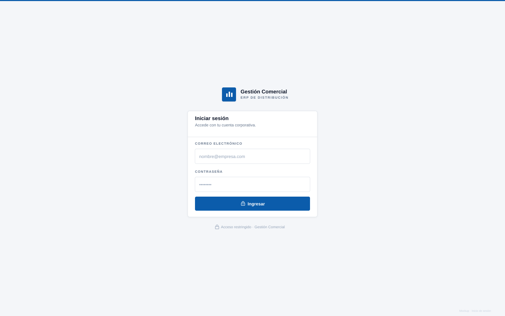
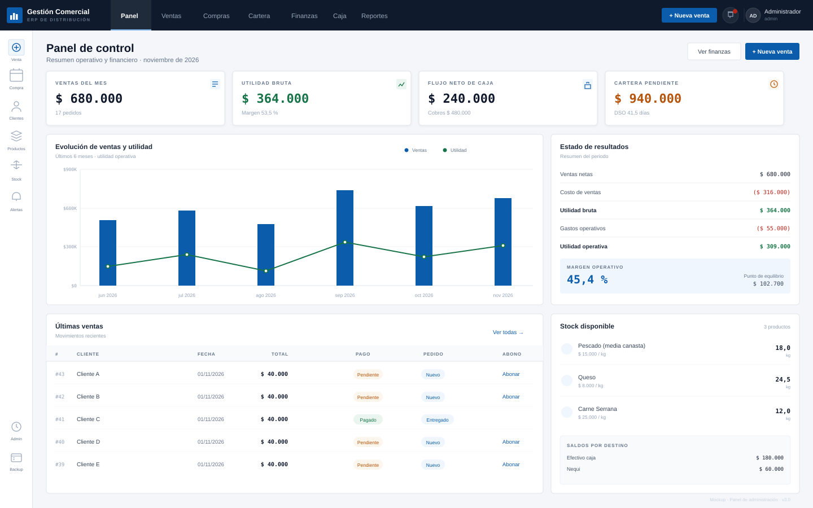
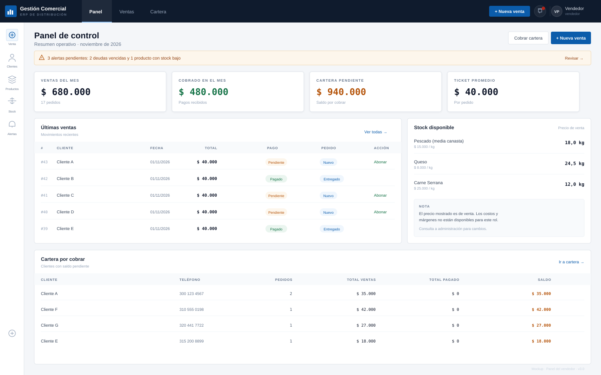
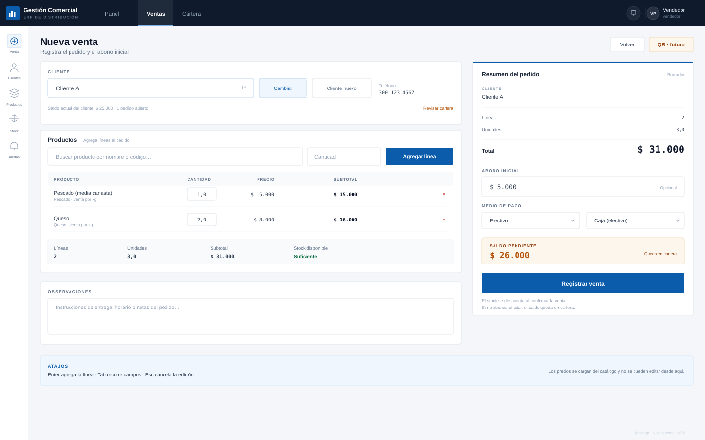
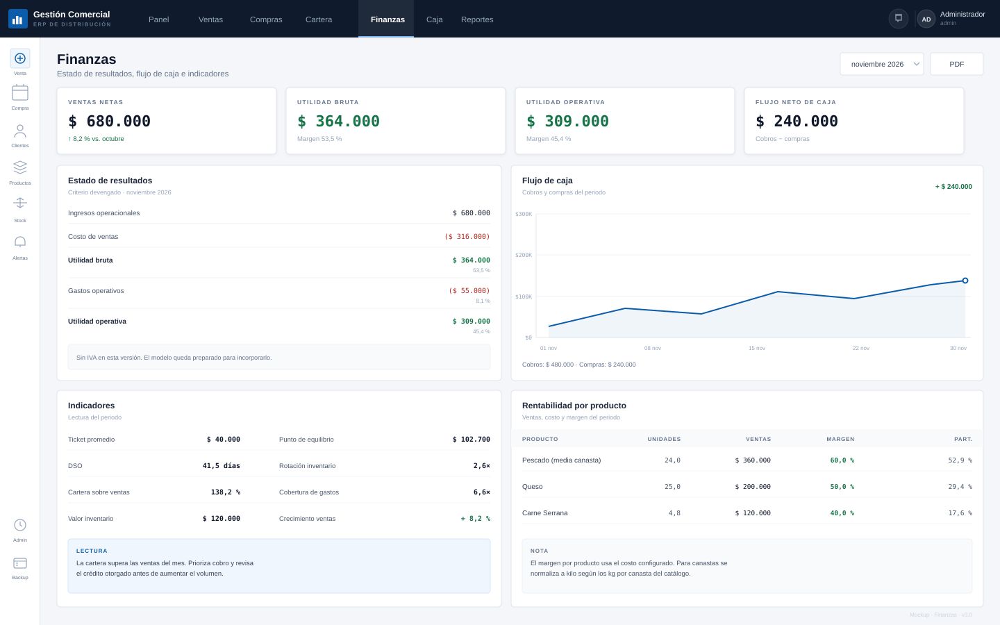
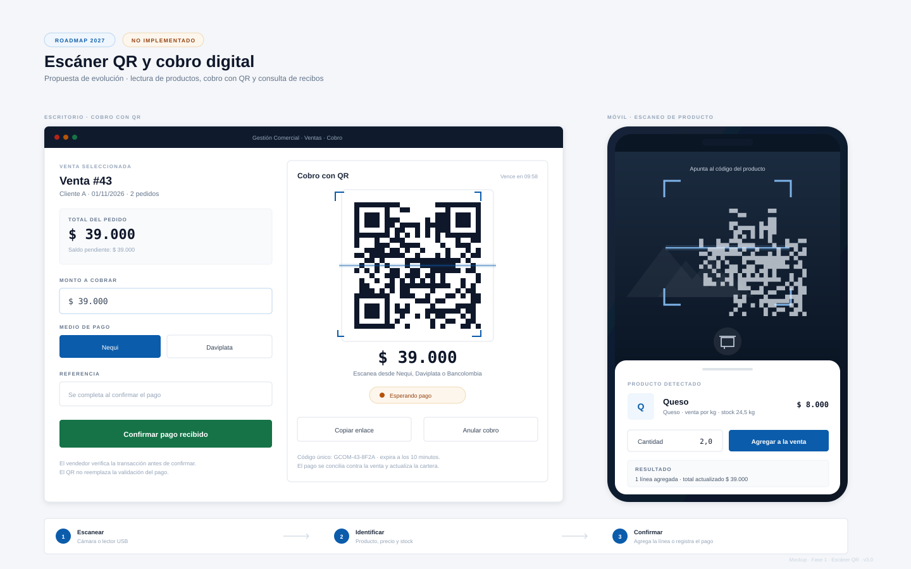

# 11 · Mockups y wireframes

Los mockups son la referencia visual del producto. No son capturas de pantalla:
son wireframes de alta fidelidad construidos con el mismo sistema de diseño de
la aplicación.

Los mockups de funciones que todavía no existen están marcados como propuesta o
como parte del roadmap. No deben interpretarse como funcionalidad disponible.

## Estado de los mockups

| Mockup | Estado |
|---|---|
| Inicio de sesión | Implementado |
| Panel del administrador | Implementado |
| Panel del vendedor | Implementado |
| Nueva venta | Implementado, sin escaneo QR |
| Finanzas | Implementado |
| Escáner QR | Propuesta, no implementado |

## Sistema visual

| Elemento | Valor |
|---|---|
| Azul corporativo | `#0B5CAB` |
| Navy de navegación | `#0F1B2D` |
| Fondo de aplicación | `#F4F6F9` |
| Superficie | `#FFFFFF` |
| Bordes | `#DFE4EA` |
| Éxito / utilidad | `#157347` |
| Advertencia | `#B45309` |
| Peligro | `#B42318` |
| Tipografía | IBM Plex Sans |
| Datos numéricos | IBM Plex Mono |
| Radios | 3–6 px |
| Densidad | Tablas compactas, tipografía 10–13 px |

### Principios de interfaz

1. El dato más importante va arriba y a la izquierda.
2. El dinero se muestra en monoespaciada y alineado a la derecha.
3. Los colores solo comunican estado, no decoran.
4. Cada pantalla tiene una acción principal clara.
5. En escritorio, el resumen de una transacción queda fijo al costado.
6. En móvil, la navegación se convierte en un drawer.

## 1. Inicio de sesión

Este mockup refleja la pantalla implementada: una sola columna centrada, sin
panel lateral.

**Qué valida**

- Marca y contexto del producto.
- Formulario mínimo: correo, contraseña y acción.
- Aviso de acceso restringido.
- Estado de error y bloqueo tras intentos fallidos.

## 2. Panel del administrador

**Qué valida**

- Lectura ejecutiva en menos de diez segundos.
- Cuatro indicadores clave y una gráfica de tendencia.
- Estado de resultados resumido.
- Últimas ventas y stock en la misma vista.
- Acceso a finanzas y nueva venta.

## 3. Panel del vendedor

**Qué valida**

- El vendedor no ve costos, márgenes ni utilidades.
- Navegación reducida a Panel, Ventas y Cartera.
- Foco en vender y cobrar.
- Cartera visible para priorizar el cobro.
- Aviso de alertas sin saturar.

## 4. Nueva venta

**Qué valida**

- Flujo de venta en una sola pantalla.
- Cliente, productos, cantidades y abono.
- Resumen fijo con total y saldo pendiente.
- El botón de escaneo QR aparece marcado como futuro; todavía no está
  implementado.
- Jerarquía clara entre editar y confirmar.

## 5. Finanzas

**Qué valida**

- Estado de resultados con criterio devengado.
- Flujo de caja separado del resultado contable.
- Indicadores con lectura práctica.
- Rentabilidad por producto.
- Aviso explícito de que no se maneja IVA.

## 6. Escáner QR (futuro)

> **Estado:** propuesta de diseño. Esta función **no está implementada** en la
> versión 3.0.0. Corresponde a la Fase 1 del roadmap.

**Qué valida**

- Cobro con QR en escritorio.
- Escaneo de producto en móvil.
- Confirmación del pago por parte del vendedor.
- Estados del cobro y expiración.
- Flujo de tres pasos: escanear, identificar, confirmar.

Este mockup corresponde a la [Fase 1 del roadmap](10-roadmap.md).

## Cómo usar los mockups

- **Diseño:** referencia de jerarquía, espaciado y componentes.
- **Desarrollo:** contrato visual de cada pantalla.
- **Negocio:** validación de flujos antes de implementar cambios.
- **Documentación:** evidencia del estado y de la evolución prevista.

## Diferencias entre mockup y producto

| Aspecto | Mockup | Producto |
|---|---|---|
| Datos | Ilustrativos | Reales del entorno |
| Interacción | Estática | Reactiva |
| Estados | Selección | Todos los estados |
| Responsive | Escritorio | Escritorio, tablet y móvil |
| Cámara QR | Propuesta | Pendiente de implementar |

## Accesibilidad

- Contraste mínimo AA en texto y fondos.
- No se depende solo del color: los estados llevan texto.
- Áreas táctiles de al menos 32 px.
- Navegación por teclado en formularios.
- Etiquetas visibles y mensajes de error claros.
- Iconos acompañados de texto o `title`.

## Impresión

Las tablas y reportes se imprimen en blanco y negro. Los botones y la navegación
se ocultan con la clase `no-print`. Los reportes PDF mantienen la jerarquía de
la pantalla.
