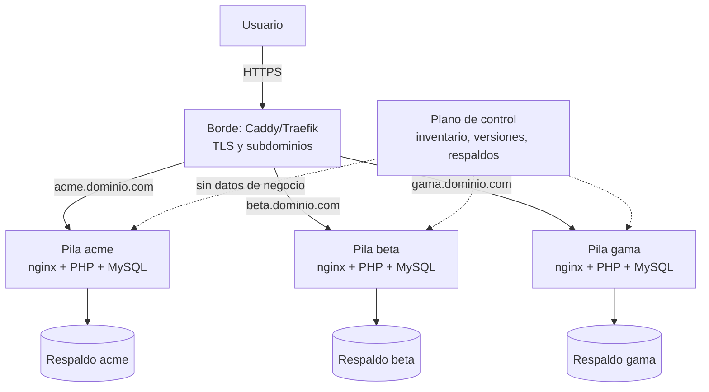

# 17 · Modelo SaaS multi-cliente

Este documento traduce la decisión técnica del
[ADR 0002](adr/0002-modelo-de-tenancy.md) a la operación y a la venta: **cada
cliente tiene su propio servicio y el alojamiento de sus datos**.

La promesa no es "una cuenta dentro de nuestra base". Es una pila propia, con
su base, sus credenciales, su respaldo y su dirección. Eso es lo que se puede
demostrar en una auditoría y lo que se cobra.

## 1. Qué se vende

| Se vende | No se vende |
|---|---|
| Una instancia del ERP con el catálogo del cliente | Un usuario en una base compartida |
| Base de datos y volumen propios | Acceso a la base de datos de otro cliente |
| Respaldo diario y restauración probada | "Los datos están en la nube" sin detalle |
| Actualizaciones del tronco común | Una bifurcación del código por cliente |
| Soporte por el canal acordado | Disponibilidad 24/7 en todos los planes |
| Subdominio y TLS | Dominio propio, salvo en el plan dedicado |

El catálogo es abierto: pescado, queso y carne son el catálogo del primer
cliente, no una restricción del producto. Categorías, productos, precios y
unidades se cargan por cliente.

## 2. Dos formas de entrega

| | **Instancia dedicada** (fase 1) | **Base dedicada** (fase 2) |
|---|---|---|
| Qué comparte | Nada: nginx, PHP y MySQL propios | Imagen y nginx; una base por cliente |
| Aislamiento | Proceso, red, volumen y credenciales | Credenciales y base; proceso compartido |
| Coste por cliente | Alto | Medio |
| Actualización | N veces, una por pila | Una sola imagen para todos |
| Cuándo | Del cliente 1 al ~6–10 | Cuando la operación de N pilas duela |
| Riesgo principal | RAM y trabajo de actualización | Enrutar mal el subdominio |

Las dos cumplen la promesa comercial. La diferencia es de coste y de operación,
no de propiedad de los datos. **En ningún caso se usa `tenant_id`.**

### Arquitectura de la fase 1



- El **borde** es el único servicio con puertos 80/443. Las pilas publican su
  nginx en `127.0.0.1:<puerto>` para que no sean accesibles saltándose el TLS.
- El **plano de control** guarda slug, plan, subdominio, versión, estado y
  último respaldo. No guarda ventas, clientes ni pagos.
- Cada pila tiene su propia red Docker, su volumen y su usuario de MySQL.

## 3. Reglas de aislamiento

Lo que **nunca** se comparte entre clientes:

1. `JWT_SECRET`: un token emitido para A no debe validar en B.
2. `APP_KEY`: la clave AES-256-GCM que cifra direcciones y notas.
3. `DB_PASSWORD` y `DB_ROOT_PASSWORD`.
4. Volumen de MySQL y red Docker.
5. Carpeta de respaldos y credenciales del almacenamiento externo.
6. Usuario de soporte con acceso a producción: se usa cuenta nominal y se
   revoca al terminar la intervención.

Lo que **sí** se comparte, a propósito:

- La imagen y el código, construidos desde el mismo commit.
- El dominio raíz y el certificado del borde.
- El procedimiento de alta, actualización y respaldo.

Prueba de aislamiento antes de cerrar un alta:

```bash
# Desde la pila de acme, intentar la base de beta con las credenciales de acme.
docker exec gcom_acme_php php -r '
  new PDO("mysql:host=gcom_beta_db;dbname=gestion_comercial", "gcom_user", getenv("DB_PASSWORD"));
'   # debe fallar: host desconocido y credencial distinta
```

## 4. Alta de un cliente

Objetivo: **menos de 30 minutos y cero SQL manual**. El procedimiento usa la
pila parametrizada de `compose.ops.yaml` (`CLIENT_SLUG`, `APP_PORT`,
`DB_VOLUME`) y el CLI `bin/tenant.php`, que se implementan en la semana 2.

### 4.1 Preparación

| Dato | Ejemplo | Regla |
|---|---|---|
| Slug | `acme` | minúsculas, sin espacios, estable para siempre |
| Subdominio | `acme.gestioncomercial.co` | DNS apuntando al borde |
| Plan | Profesional | Define límites, respaldos y SLA |
| Puerto local | `8090` | Uno por pila; nunca el 8080 del cliente 1 |
| Volumen | `gc_acme_db_data` | Único por cliente |
| Correo del administrador | `admin@acme.co` | Se usa para el primer acceso |

### 4.2 Comandos

```bash
# 1. Crear el entorno y los secretos (no se reutilizan de otro cliente).
bin/tenant.php new acme --plan=profesional --port=8090

# Equivale a:
#   cp .env.example .env.acme
#   APP_ENV=production
#   APP_URL=https://acme.gestioncomercial.co
#   CLIENT_SLUG=acme / APP_PORT=8090 / DB_VOLUME=gc_acme_db_data
#   JWT_SECRET, APP_KEY, DB_PASSWORD y DB_ROOT_PASSWORD nuevos

# 2. Construir y levantar desde el commit etiquetado.
docker compose --env-file .env.acme -f compose.ops.yaml -p gc-acme up -d --build

# 3. Crear el administrador.
docker compose --env-file .env.acme -f compose.ops.yaml -p gc-acme \
  exec -T -e RESET_PASSWORD='<clave-inicial>' php \
  php bin/reset-admin-password.php admin@acme.co --create

# 4. Verificar antes de publicar.
curl -fsS http://127.0.0.1:8090/api/v1/auth/login   # 405/400, no 502

# 5. Publicar en el borde y comprobar TLS.
bin/tenant.php publish acme
curl -fsSI https://acme.gestioncomercial.co

# 6. Primer respaldo y registro en el inventario.
bin/tenant.php backup acme
bin/tenant.php status acme
```

### 4.3 Checklist de entrega

- [ ] Login con el administrador del cliente y cambio de clave.
- [ ] Catálogo cargado (categorías, productos, precios) o importado.
- [ ] Un usuario por rol creado y probado (admin, vendedor, solo lectura).
- [ ] Una venta de prueba creada, cobrada y anulada; totales coherentes.
- [ ] Respaldo generado, descargado y **restaurado en una pila limpia**.
- [ ] HTTPS válido y HTTP redirigiendo.
- [ ] `APP_ENV=production` y errores internos ocultos.
- [ ] Respaldos automáticos programados y alerta de fallo.
- [ ] Inventario actualizado: versión, subdominio, plan, contacto.
- [ ] Acta de entrega con URL, usuarios y alcance del soporte.

## 5. Actualizaciones y versiones

El código es uno. Lo que cambia por cliente es la configuración y los datos.

| Paso | Quién | Regla |
|---|---|---|
| 1. Etiquetar | Desarrollo | `v3.1.0` solo desde `main` con CI en verde |
| 2. Probar en desarrollo | Desarrollo | Tests y E2E sobre 8081 |
| 3. Cliente piloto | Operación | Primero el cliente 1 o el que acepte ventana |
| 4. Resto | Operación | Uno por uno, con respaldo previo |
| 5. Reversión | Operación | Volver a la etiqueta anterior y restaurar si hubo migración |

Reglas:

- Ninguna migración se aplica sin respaldo previo verificado.
- Las migraciones deben ser idempotentes y probadas en una copia de datos
  reales anonimizada.
- Ventana de mantenimiento: domingo 02:00–04:00 (hora del cliente) salvo
  acuerdo. Fuera de ventana solo seguridad crítica.
- Si un cliente necesita una función que no está en el tronco, se desarrolla
  como módulo configurable y se incorpora; **no se mantiene una bifurcación**.

## 6. Respaldos y continuidad

| Concepto | Propuesta |
|---|---|
| Frecuencia | Diario automático + manual antes de cada despliegue |
| Retención | 7 diarios, 4 semanales, 12 mensuales (según plan) |
| Ubicación | Fuera del host, cifrado en reposo |
| Nombre | `acme-20261123-0200.sql.gz` |
| RPO | 24 horas |
| RTO | 4 horas |
| Prueba de restauración | Trimestral, con acta y duración medida |

El respaldo que no se ha restaurado no cuenta. La prueba se hace en una pila
limpia, no encima de la operación:

```bash
bin/tenant.php restore acme --into=restore-acme --check
# Compara conteos y totales contra el respaldo y luego destruye la pila temporal.
```

## 7. Soporte y SLA

| Plan | Canal | Horario | Respuesta crítica | Respuesta normal |
|---|---|---|---|---|
| Esencial | Correo/WhatsApp | Lun–vie 8:00–17:00 | 8 h hábiles | 2 días hábiles |
| Profesional | Correo/WhatsApp | Lun–sáb 8:00–20:00 | 4 h | 1 día hábil |
| Dedicado | Canal directo | Lun–dom 7:00–22:00 | 2 h | 8 h |

- **Crítico:** no se puede iniciar sesión, no se puede cobrar o los datos
  aparecen corruptos. Se atiende primero y se comunica cada 2 horas.
- **Normal:** error en un reporte, duda de uso, cambio de catálogo.
- **Mejora:** nueva función o integración; entra en la planificación, no en el
  SLA.
- Mantenimiento programado no cuenta como indisponibilidad si se avisa con 48 h.

## 8. Paquetes y precio

> **Borrador para validar con el primer cliente.** No es una cotización. Los
> valores están en COP y sirven para discutir estructura y margen, no para
> publicar.

| | **Esencial** | **Profesional** | **Dedicado** |
|---|---|---|---|
| Instancia | Compartida en host (pila propia) | Pila propia en host compartido | VPS propio |
| Usuarios | 3 | 10 | Sin límite práctico |
| Productos | 300 | 2.000 | Sin límite práctico |
| Ventas/mes | 3.000 | 15.000 | Sin límite práctico |
| Respaldo | 7 días | 30 días | 90 días |
| Subdominio | `cliente.dominio.com` | `cliente.dominio.com` | Dominio propio opcional |
| Soporte | Esencial | Profesional | Dedicado |
| Precio/mes (borrador) | 150.000–250.000 | 350.000–450.000 | 800.000–1.200.000 |
| Implementación (una vez) | 1–2 salarios/día | 2–3 | A convenir |

Servicios adicionales, siempre cotizados aparte:

- Migración de datos históricos (CSV, Excel, base anterior).
- Capacitación adicional o presencial.
- Reportes a medida e integraciones (Chulito, WhatsApp, pasarela de pago).
- Retención extendida de respaldos.
- Acompañamiento en el cierre contable.

Reglas comerciales:

1. **Instalación incluida** en el primer año; después se cobra el alta.
2. **Pago mensual anticipado**; anual con 10–15 % de descuento.
3. **Impago:** aviso a los 5 días, suspensión a los 15, datos conservados 30
   días y luego exportación y borrado.
4. **Ajuste anual** por inflación o costo de infraestructura, avisado con 30
   días.
5. **Datos del cliente son del cliente.** Se entregan en SQL/CSV al día
   siguiente de solicitarlo, incluso si termina la relación.

### Estructura de coste por cliente

| Concepto | Orden de magnitud |
|---|---|
| VPS compartido (6 clientes en 8 GB) | ~20.000 COP/mes por cliente |
| Almacenamiento de respaldos | ~5.000–15.000 COP/mes |
| Dominio y TLS | ~5.000 COP/mes (TLS automático) |
| Soporte (1–2 h/mes a coste interno) | variable, el mayor costo |
| Pasarela de pago | 2,5–4 % de lo cobrado, si se usa |

Con eso, un plan Profesional de 400.000 COP deja margen para soporte e
infraestructura. El número se cierra con el primer contrato real, no antes.

## 9. Seguridad, privacidad y baja

- **Roles:** el cliente es dueño de sus datos; el proveedor actúa como
  encargado del tratamiento. Se firma acuerdo de tratamiento de datos.
- **Acceso a producción:** solo con autorización del cliente, cuenta nominal,
  registro de la intervención y sin descargar datos a equipos personales.
- **Cifrado:** TLS en tránsito; AES-256-GCM para direcciones y notas; respaldos
  cifrados en reposo.
- **Secretos:** por cliente, rotables y fuera de Git. `.env` nunca se versiona.
- **Baja:** exportación completa, verificación de que el cliente la recibió,
  borrado de la pila y del volumen, y constancia escrita. Los respaldos se
  conservan como máximo 30 días salvo obligación legal.
- **Incidentes:** notificación al cliente afectado en menos de 72 horas, con
  alcance, causa y medidas. Si hay datos personales, se sigue la norma local.

## 10. Límites y cuándo subir de plan

| Señal | Umbral | Acción |
|---|---|---|
| Clientes por host | 6–10 | Repartir en otro host o pasar a fase 2 |
| RAM del host | > 80 % sostenido | Mover un cliente o ampliar |
| Base de un cliente | > 5 GB | Revisar retención y plan Dedicado |
| Ventas/mes | > límite del plan | Subir de plan |
| Respaldos | > 20 min o fallan | Revisar tamaño y ventana |
| Personalizaciones | > 20 % del código | Módulo configurable o plan Dedicado |

## 11. Qué falta para vender (estado real)

| Pieza | Estado | Semana |
|---|---|---|
| Pila parametrizada por cliente | Pendiente | 2 |
| `bin/tenant.php` (new/backup/restore/status) | Pendiente | 2 |
| Borde con TLS y subdominios | Pendiente | 2 |
| Inventario de clientes | Pendiente | 2 |
| Respaldo automático fuera del host | Pendiente | 3 |
| Monitoreo y alertas | Pendiente | 3 |
| `APP_ENV=production` en operación | **Corregir ya** | 2 |
| Runbook de actualización y reversión | Pendiente | 3 |
| Contrato y acuerdo de datos | Pendiente | Comercial |
| Facturación y cobro recurrente | Pendiente | Comercial |
| Demo con datos ficticios | Pendiente | Comercial |

## 12. Riesgos

| Riesgo | Impacto | Mitigación |
|---|---|---|
| Todos los clientes en un host | Caída general | Límite de densidad y host de respaldo |
| Actualizar N pilas a mano | Deriva de versiones | CLI, etiquetas y cliente piloto |
| Respaldo nunca restaurado | Pérdida real | Prueba trimestral con acta |
| Dependencia de una persona | Operación frágil | Runbooks y accesos documentados |
| MySQL consume RAM | Lentitud | Límites por contenedor y métricas |
| Fuga de secretos | Suplantación | Secretos por cliente y rotación |
| Cliente pide "su versión" | Bifurcación | Módulo configurable o plan Dedicado |
| Certificado o dominio vence | Caída y desconfianza | Renovación automática y alerta |

## 13. Decisiones pendientes

1. Un VPS por cliente desde el inicio o densidad de 6 por host.
2. Dominio y certificado incluidos o facturados aparte.
3. Retención y RPO/RTO definitivos por plan.
4. Dónde vive el plano de control.
5. Precio de la implementación y qué incluye exactamente.
